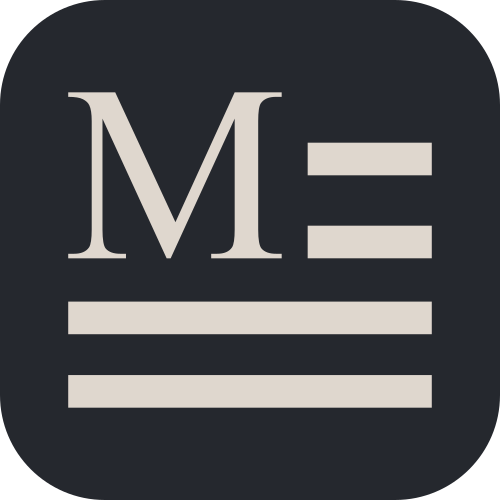
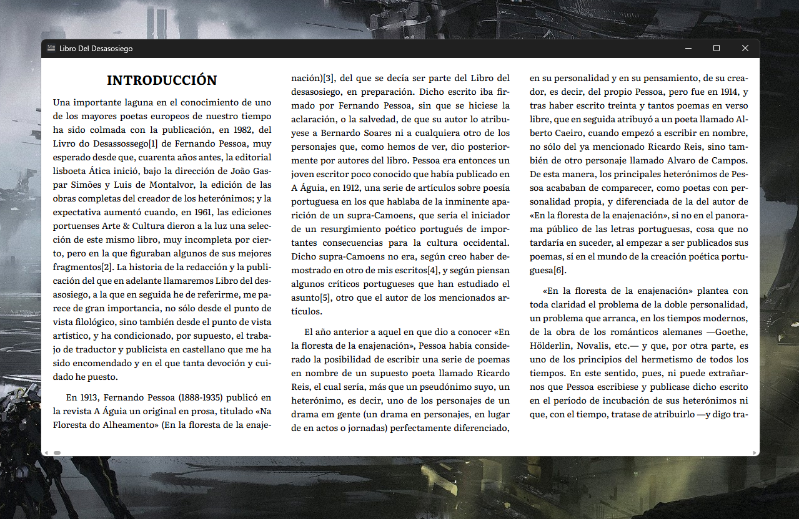

<div align="center">
  

# Miso

**A distraction-free desktop reader that lays text out in narrow columns.**
One document per window. No network, no library, no editing — just reading.

[](https://tauri.app)
[](https://svelte.dev)
[](https://www.rust-lang.org)
[](#requirements)
[](#languages)

<br />

<picture>
  <source media="(prefers-color-scheme: dark)" srcset="assets/screenshots/miso-dark.png" />
  
</picture>

</div>

---

## Why Miso

Long lines are hard to read. Miso splits a document into narrow, newspaper-like columns and moves you between them, remembering the exact spot where you stopped. Everything is local and offline.

- **Columns, not scrolling** — one document per window, laid out for comfortable reading.
- **Resumes where you left off** — reading position is stored per document, per window.
- **Formats** — `.txt`, `.rtf`, `.docx`, `.html`, `.epub`, `.pdf`, and plain text pasted from the clipboard.
- **Typography first** — system fonts, adjustable zoom, light and dark backgrounds, hyphenation.
- **Quiet by design** — no accounts, no sync, no telemetry, no network access.

## Keyboard shortcuts

| Action | Shortcut |
| --- | --- |
| Next / previous column | `→` `↓` / `←` `↑` |
| Next / previous page of columns | `Space` / `Shift` + `Space` |
| Next / previous page | `PageDown` / `PageUp` |
| First / last column | `Home` / `End` |
| Open document | `Ctrl` + `O` |
| Save a copy | `Ctrl` + `S` |
| Open text from clipboard | `Ctrl` + `V` |
| Find | `Ctrl` + `F` |
| Next / previous match | `F3` / `Shift` + `F3` |
| Zoom in / out / reset | `Ctrl` + `=` / `Ctrl` + `-` / `Ctrl` + `0` |
| Toggle light / dark background | `Ctrl` + `I` |
| Preferences | `Ctrl` + `,` |
| Fullscreen | `F11` |
| Close preferences, find bar or fullscreen | `Esc` |

## Requirements

- Windows 10/11 with WebView2 (included in current Windows builds)
- Node.js and pnpm 10 for the frontend
- Rust 1.90 or newer for the desktop shell

## Development

```sh
pnpm install
pnpm tauri dev     # run the app in development
pnpm verify        # clippy, Rust tests, svelte-check, unit and layout tests
```

Layout tests drive Chromium through Playwright (`pnpm exec playwright install chromium`).

Handy individual scripts: `pnpm check`, `pnpm test`, `pnpm test:layout`, `pnpm lint:rust`, `pnpm test:rust`.

## Project layout

- `src/` — Svelte 5 interface: columns, navigation, preferences.
- `src-tauri/` — Rust core on Tauri 2: importers, windows, reading positions.
- `locales/` — translations (11 languages).
- `ARCHITECTURE.md` — technical design. `DECISIONES.md` — fixed decisions.

## Languages

German, English, Spanish, Finnish, French, Italian, Norwegian Bokmål, Dutch, Portuguese, Russian, Swedish.

## Third-party

PDF rendering uses [PDFium](https://pdfium.googlesource.com/pdfium/) (`src-tauri/pdfium/pdfium.dll` 158.0.8125.0, built by [pdfium-binaries](https://github.com/bblanchon/pdfium-binaries)). License texts ship in `src-tauri/pdfium/`; see [`THIRD_PARTY_NOTICES.md`](THIRD_PARTY_NOTICES.md).

## License

MIT — see [`LICENSE`](LICENSE). Third-party components keep their own licenses, listed in [`THIRD_PARTY_NOTICES.md`](THIRD_PARTY_NOTICES.md) (generated by `pnpm gen:licenses`; do not edit by hand). The same notices are embedded in the app: Preferences → Licenses.
